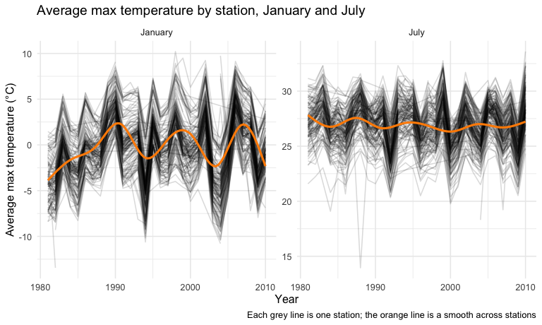
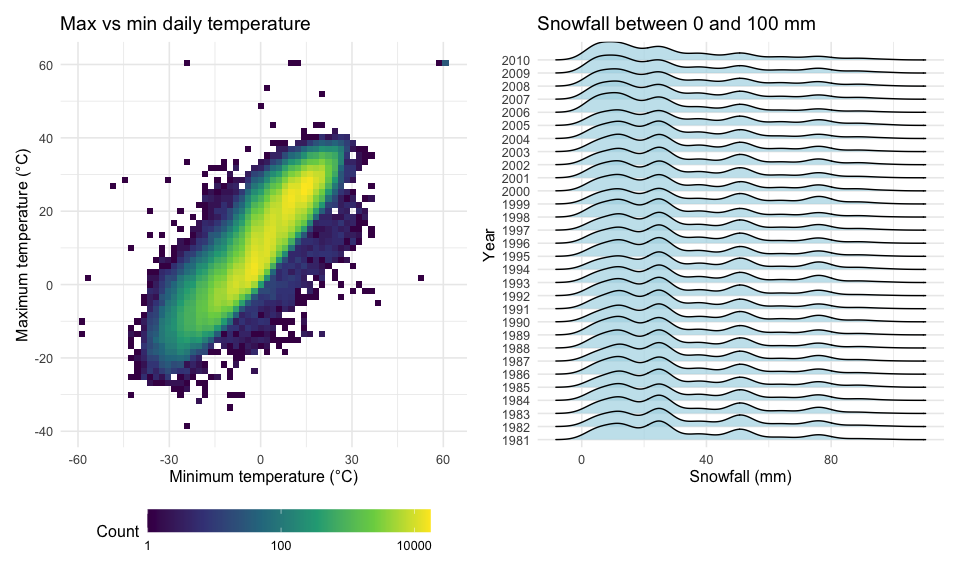

p8105_hw3_zz3593
================
Ziang Zhang
2026-10-20

``` r
library(tidyverse)
library(p8105.datasets)
library(patchwork)
library(ggridges)

knitr::opts_chunk$set(
  fig.width = 8,
  fig.asp = .6,
  out.width = "90%"
)

theme_set(theme_minimal(base_size = 12) + theme(legend.position = "bottom"))
```

# Problem 1

``` r
data("ny_noaa")

noaa_missing =
  ny_noaa |>
  summarize(across(prcp:tmin, \(x) mean(is.na(x))))

n_stations_noaa = n_distinct(ny_noaa$id)
n_stations_no_temp =
  ny_noaa |>
  group_by(id) |>
  summarize(no_temp = all(is.na(tmax))) |>
  filter(no_temp) |>
  nrow()
```

The `ny_noaa` dataset contains daily weather records from NOAA weather
stations in New York State. It has 2,595,176 rows and 7 columns, with
one row per station per day, covering 747 stations from 1981-01-01 to
2010-12-31. Key variables are the station `id`, the `date`,
precipitation (`prcp`, tenths of mm), snowfall (`snow`, mm), snow depth
(`snwd`, mm), and maximum and minimum temperature (`tmax`, `tmin`,
tenths of degrees C; stored as character). Missing data is a major
issue: 5.6% of `prcp`, 14.7% of `snow`, 22.8% of `snwd`, and about 43.7%
of `tmax` and `tmin` are missing. Many stations only record
precipitation and snow; 510 of the 747 stations never report a
temperature.

``` r
noaa_df =
  ny_noaa |>
  separate(date, into = c("year", "month", "day"), convert = TRUE) |>
  mutate(
    tmax = as.numeric(tmax) / 10,
    tmin = as.numeric(tmin) / 10,
    prcp = prcp / 10
  )

noaa_df |>
  count(snow, sort = TRUE) |>
  head(8) |>
  knitr::kable(col.names = c("Snowfall (mm)", "Number of days"))
```

| Snowfall (mm) | Number of days |
|--------------:|---------------:|
|             0 |        2008508 |
|            NA |         381221 |
|            25 |          31022 |
|            13 |          23095 |
|            51 |          18274 |
|            76 |          10173 |
|             8 |           9962 |
|             5 |           9748 |

I split `date` into integer `year`, `month`, and `day` variables,
converted `tmax` and `tmin` from character to numeric and from tenths of
degrees C to degrees C, and converted `prcp` from tenths of mm to mm.
Snowfall and snow depth are already in mm and were left unchanged.

For snowfall, the most common value by far is 0: most days in New York
have no snow, and snow is impossible for much of the year. The next most
common value is `NA`, reflecting the missingness above. Among nonzero
values, the most common are 25, 13, 51, and 76 mm. These correspond to
1, 0.5, 2, and 3 inches, which suggests snowfall is usually measured in
(half) inches by observers and then converted to mm.

``` r
noaa_df |>
  filter(month %in% c(1, 7)) |>
  group_by(id, year, month) |>
  summarize(mean_tmax = mean(tmax, na.rm = TRUE)) |>
  drop_na(mean_tmax) |>
  mutate(month = factor(month, levels = c(1, 7), labels = c("January", "July"))) |>
  ggplot(aes(x = year, y = mean_tmax)) +
  geom_line(aes(group = id), alpha = .15) +
  geom_smooth(se = FALSE, color = "darkorange") +
  facet_wrap(~ month, scales = "free_y") +
  labs(
    title = "Average max temperature by station, January and July",
    x = "Year",
    y = "Average max temperature (°C)",
    caption = "Each grey line is one station; the orange line is a smooth across stations"
  )
```



Each grey line is one station’s average daily maximum temperature in
that month and year. As expected, January is much colder than July
(roughly 0°C versus 27°C on average), and January temperatures vary more
across stations and years. Within each month, stations move up and down
together from year to year, so most variation comes from year-to-year
weather (e.g. a cold January in 1994 and warm Januaries in 1990, 2002,
and 2006) rather than from station differences. There is no strong
long-term trend over this 30-year period. A few stations stand out as
outliers, such as a station with an average January max of about -13°C
in 1982, and a station with an unusually cold July in 1988 (about 14°C,
far below all other stations).

``` r
tmax_tmin_p =
  noaa_df |>
  drop_na(tmax, tmin) |>
  ggplot(aes(x = tmin, y = tmax)) +
  geom_bin2d(bins = 60) +
  scale_fill_viridis_c(trans = "log10") +
  labs(
    title = "Max vs min daily temperature",
    x = "Minimum temperature (°C)",
    y = "Maximum temperature (°C)",
    fill = "Count"
  ) +
  theme(legend.key.width = unit(1.5, "cm"))

snow_p =
  noaa_df |>
  filter(snow > 0, snow < 100) |>
  mutate(year = factor(year)) |>
  ggplot(aes(x = snow, y = year)) +
  geom_density_ridges(scale = 1.5, fill = "lightblue", alpha = .7) +
  labs(
    title = "Snowfall between 0 and 100 mm",
    x = "Snowfall (mm)",
    y = "Year"
  )

tmax_tmin_p + snow_p
```

    ## Picking joint bandwidth of 3.76



Because there are over a million days with both temperatures recorded, a
scatterplot would mostly show overplotting, so the left panel uses a 2D
binned plot with counts on a log scale. Maximum and minimum temperatures
are strongly positively related, and most days fall in a dense band just
above the line `tmax = tmin`. A small number of points have `tmax` below
`tmin` or extreme values (e.g. 60°C), which are likely recording errors.

The right panel shows the distribution of snowfall between 0 and 100 mm
in each year. The distributions are very similar across years: they are
multimodal, with peaks at about 13, 25, 51, and 76 mm, matching the
half-inch and inch values noted above. The median nonzero snowfall in
this range is 25 mm in every year. From about 2006 onward, a slightly
larger share of values are small (roughly 20% below 10 mm, compared with
about 15% in earlier years), and the number of snowfall records also
increases, possibly reflecting new stations or changes in measurement
practice.
